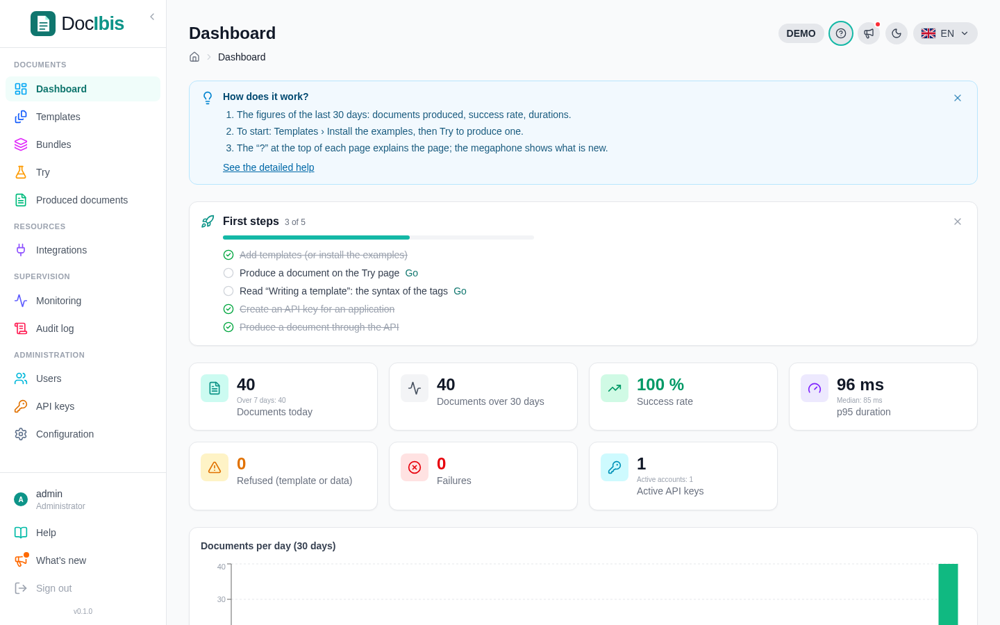
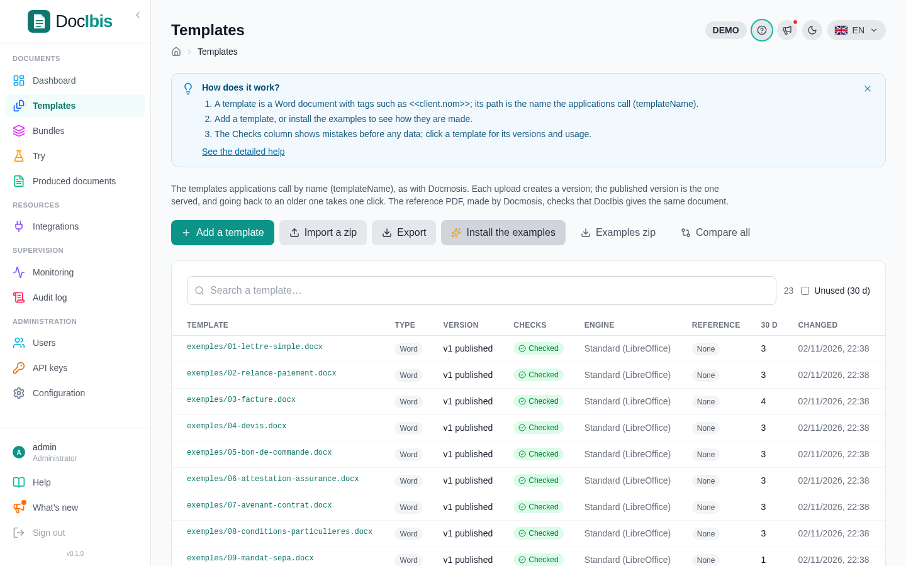
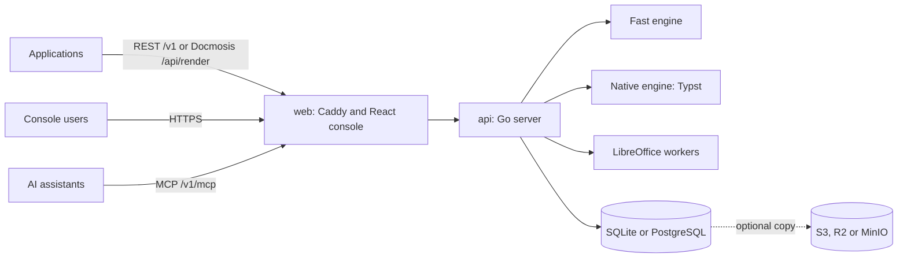
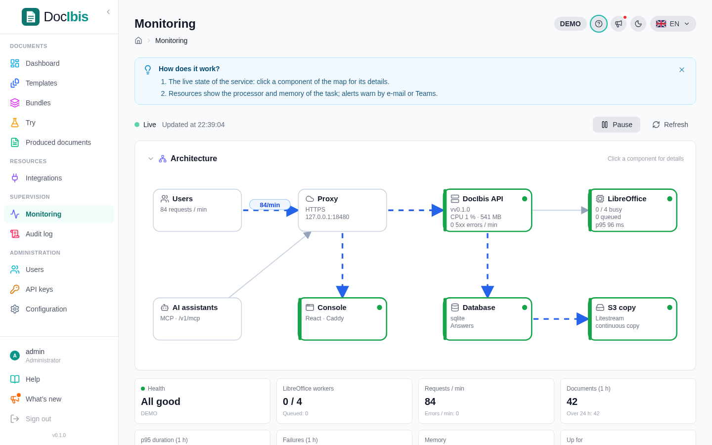

<p align="center">
  
</p>

<p align="center">
  <strong>Send a Word template and JSON data, get a finished PDF back in one API call.</strong>
  <br>
  Free, open source and self-hosted, compatible with Docmosis templates, with a web console for the template library.
</p>

<p align="center">
  <a href="https://github.com/drslid/docibis/actions/workflows/ci.yml"></a>
  
  
  
  
  <a href="https://drslid.github.io/docibis/"></a>
  <a href="LICENSE"></a>
</p>

> [!IMPORTANT]
> DocIbis is alpha software. Compare the documents it produces from your own templates before relying on it, and keep a copy of its database.

## Quick install

You need:

- a Linux server or virtual machine, `amd64` (x86-64), with `curl`;
- `root` access or a user with `sudo`;
- at least 2 GB RAM and 4 GB free disk;
- TCP port `8080` open, or `80` and `443` with a domain name for HTTPS.

Run this single command on the server. It installs the pinned `v0.1.0` release:

```bash
curl -fsSL https://raw.githubusercontent.com/drslid/docibis/v0.1.0/install.sh | sudo env DOCIBIS_REF=v0.1.0 bash
```

The installer asks for the database and, optionally, a domain name. It then:

1. verifies the operating system, architecture, memory and disk;
2. installs Docker Engine and Docker Compose when required;
3. downloads the release into `/opt/docibis`;
4. writes `/opt/docibis/.env` with generated secrets;
5. pulls the `docibis-api` and `docibis-web` images from GHCR, or builds them when absent;
6. starts the stack and waits for the API.

At completion, the terminal prints the address and a one-time setup code:

```text
==> DocIbis is running: http://203.0.113.10:8080
    Setup code: K7QM-2XV9
    Open the address, enter this code and create the first administrator.
    Folder: /opt/docibis (configuration in .env, fonts in fonts/)
    Logs:   cd /opt/docibis && docker compose logs -f
```

Open the address, enter the code and create the administrator account. **Templates → Install the examples** adds sample templates and data to try the service.

Without questions, for example with PostgreSQL and HTTPS:

```bash
curl -fsSL https://raw.githubusercontent.com/drslid/docibis/v0.1.0/install.sh \
  | sudo env DOCIBIS_REF=v0.1.0 DOCIBIS_YES=1 DOCIBIS_DB=postgres DOCIBIS_DOMAIN=docs.example.com bash
```

| Variable                | Values                                         | Default        |
| ----------------------- | ---------------------------------------------- | -------------- |
| `DOCIBIS_REF`           | release tag, or `main` for the latest build     | `main`         |
| `DOCIBIS_DIR`           | installation folder                             | `/opt/docibis` |
| `DOCIBIS_DB`            | `sqlite`, `postgres` or `external`              | `sqlite`       |
| `DOCIBIS_DATABASE_URL`  | `postgres://…` address, with `external`         |                |
| `DOCIBIS_DOMAIN`        | domain name pointing to the server, for HTTPS   | plain HTTP     |
| `DOCIBIS_PORT`          | HTTP port, without a domain                     | `8080`         |
| `DOCIBIS_YES`           | `1`: use the variables, ask nothing             |                |

## What DocIbis is

DocIbis is a document generation service. An application sends a Word template, or the name of a template kept in the DocIbis library, with JSON data; DocIbis merges them and returns a PDF or a Word document. Templates use the Docmosis tag syntax, so existing Docmosis templates and calls keep working. LibreOffice 26.8 lays out the pages.

<p align="center">
  
</p>

```bash
curl -H "Authorization: Bearer $DOCIBIS_API_KEY" \
  -F templateName=exemples/03-facture.docx \
  -F data=@invoice.json \
  -o invoice.pdf https://docs.example.com/v1/render
```

### Included

- REST API under `/v1`, described by an OpenAPI contract, with an interactive reference at `/docs`.
- Docmosis-compatible `POST /api/render`: point existing clients to DocIbis.
- Template library with folders, versions, scheduled publication, rollback, comparison of two versions and checks at import.
- Renaming and merging templates: former names keep working, so applications move to the new names at their own pace.
- Reference documents: a new version is compared page by page with the PDFs it must reproduce.
- Bundles (several templates and PDF files in one document) and batch rendering.
- PDF, DOCX, PDF/A-1b, 2b and 3b, accessible PDF (PDF/UA-1, checked with veraPDF), watermarks, passwords and permissions.
- A fast engine for fixed-layout templates, qualified automatically, in about a millisecond per document.
- A native engine: a Typst copy of a template version, compared page by page with LibreOffice before it is used, renders in a few milliseconds; any new Word version falls back to LibreOffice until its copy is checked again.
- Background rendering: `POST /v1/render/async` answers at once with a job; the document is read later, uploaded to a presigned S3 address, and a signed callback (HMAC, `WEBHOOK_SECRET`) tells the end.
- PDF forms (CERFA and others): a PDF with form fields is filled with the data, then its fields are locked.
- An n8n node (`integrations/n8n-nodes-docibis`): render now or in the background, follow a job, list the templates.
- An MCP server at `/v1/mcp` so that AI assistants can list templates and produce documents.
- Administrator, editor and viewer roles, second factor (TOTP), API keys with scopes and expiry, audit log.
- History of produced documents, statistics per template, alert rules by e-mail or Teams, Prometheus metrics.
- Promotion of a template version from one DocIbis instance to another, for example from test to production.
- Console in English, French, German and Italian, with a dark mode.

<p align="center">
  
</p>

### Template syntax

| In the Word template                               | Produces                                  |
| -------------------------------------------------- | ----------------------------------------- |
| `<<client.name>>`                                  | a value of the data                       |
| `<<amount{numFormat='#,##0.00'}>>`                 | a formatted number                        |
| `<<start{dateFormat='dd/MM/yyyy'}>>`               | a formatted date                          |
| `<<cs_{client.vip = true}>>` … `<<else>>` … `<<es_>>` | a conditional section                  |
| `<<rr_lines>>` … `<<er_lines>>`                    | one table row per item                    |
| `<<rs_people>>` … `<<es_people>>`                  | one section per item                      |
| `<<{toUpper(client.name)}>>`                       | an expression with functions              |
| `<<op:client.address2>>`                           | a paragraph removed when the value is empty |
| `<<{qrcode(contract.link)}>>`                      | a QR code or a barcode                    |
| an image with the bookmark `imgfit_logo`           | the image of the field `logo`             |

The console analyses a template, lists the data it expects and generates sample JSON. The complete reference is in **Help** within the console.

## Database

The installer offers three choices, written in `/opt/docibis/.env`:

| Choice                     | `.env`                                          | For                                   |
| -------------------------- | ----------------------------------------------- | ------------------------------------- |
| SQLite (default)           | `DATABASE_URL=''`                               | one server; data in the `data` volume |
| PostgreSQL 18 in Docker    | `COMPOSE_PROFILES=postgres` and `DATABASE_URL`  | one server, ready to grow             |
| Existing PostgreSQL 15+    | `DATABASE_URL='postgres://…'`                   | managed databases, several instances  |

With SQLite, Litestream keeps a continuous copy of the database in the data volume (`/data/replica`). To send this copy to S3, Cloudflare R2 or MinIO instead, and restore it at start-up on a new server, set these lines in `.env`, then run `docker compose up -d`:

```bash
STATE_URL=s3://bucket/docibis?region=eu-west-3
# R2 or MinIO: STATE_URL=s3://bucket/docibis?endpoint=https://storage.example.com&region=auto
AWS_ACCESS_KEY_ID=...
AWS_SECRET_ACCESS_KEY=...
```

## Fonts

The image includes free fonts with the same metrics as Arial, Times New Roman, Courier New, Calibri and Cambria (Liberation, Carlito, Caladea), plus DejaVu and Noto. Licensed fonts, such as Microsoft or corporate fonts, are not distributed: copy their `.ttf` or `.otf` files to `/opt/docibis/fonts`, then run:

```bash
cd /opt/docibis && docker compose restart api
```

## Operations

```bash
cd /opt/docibis
docker compose ps                  # state of the containers
docker compose logs -f api         # logs
docker compose down                # stop; data is kept in Docker volumes
```

- **Update:** run the installer again with the new tag. `.env` and the data are kept.
- **Backup:** with SQLite, copy the `docibis_data` volume or use `STATE_URL`; with PostgreSQL, use `pg_dump`. Keep `APP_SECRET_KEY` with the backup: it seals the second-factor secrets.
- **Uninstall:** `docker compose down -v` removes the containers **and the data**, then delete `/opt/docibis`.
- **Settings:** limits, retention, e-mail, security and branding are set in the console, under **Configuration**.

### Kubernetes

A Helm chart is in `deploy/helm/docibis`: the API (with a data volume for SQLite, or PostgreSQL for several pods), the console, an optional ingress, read-only containers without privileges. The images are published for `linux/amd64` and `linux/arm64` (AWS Graviton, Ampere), usually cheaper.

```bash
helm install docibis deploy/helm/docibis \
  --set appSecretKey=$(openssl rand -hex 24) \
  --set ingress.enabled=true --set ingress.host=docs.example.com
```

## Architecture



The `web` container serves the console and forwards `/api` and `/v1` to the `api` container, which is not published. With a domain name, Caddy obtains and renews the HTTPS certificate. The `api` container runs the Go server and its pool of LibreOffice workers in the same image.

<p align="center">
  
</p>

## Documentation

The complete documentation, with screenshots of each step, lives at **[drslid.github.io/docibis](https://drslid.github.io/docibis/)**:

- [Install](https://drslid.github.io/docibis/getting-started/install/) and [first steps](https://drslid.github.io/docibis/getting-started/first-steps/)
- [Write a template](https://drslid.github.io/docibis/guides/templates/)
- [Produce documents by API](https://drslid.github.io/docibis/guides/api/), including Docmosis clients
- [Configuration](https://drslid.github.io/docibis/operations/configuration/) and [day-to-day operations](https://drslid.github.io/docibis/operations/maintenance/)

## Development

```bash
echo "APP_SECRET_KEY=$(openssl rand -hex 24)" > .env
docker compose up -d --build       # console and API on http://localhost:8080
```

Run the tests, or the console with hot reload against that API:

```bash
cd apps/api && go test ./...
cd apps/web && npm ci && npm test && npm run dev
```

`apps/api/openapi.yaml` is the contract; `go generate ./internal/httpapi` and `npm run generate` regenerate the Go server and the TypeScript client after a change.

```text
apps/api        Go API, merge engine, LibreOffice worker, migrations, OpenAPI contract
apps/web        React console and Caddy configuration
apps/docs       Documentation site (Astro Starlight), published on GitHub Pages
compose.yaml    Docker Compose stack used by install.sh
deploy/helm     Helm chart for Kubernetes
integrations    n8n node
install.sh      One-line installer
```

## Security and scope

- Passwords are hashed; second-factor secrets are sealed with `APP_SECRET_KEY`.
- API keys are stored as hashes, carry scopes and can expire.
- Session cookies are HTTP-only and secure behind HTTPS; the console sends security headers.
- LibreOffice runs without macros or external links, as a non-root user.
- The API image has no shell and no package manager (distroless): only the files the service runs, from Debian packages still listed for scanners. Each release image is scanned with Trivy; a fixable high or critical vulnerability stops the release.
- Images given by address in the data are fetched only from allowed hosts; callback and upload addresses only reach allowed HTTPS hosts, never the loopback nor the metadata addresses, and are never stored nor logged.
- Secrets, `.env` files, fonts and produced documents must never be committed.

DocIbis is not affiliated with Docmosis. It reproduces the template syntax and the `/api/render` call to ease migrations; check the documents produced from your templates before switching.

## License

DocIbis is available under the [MIT License](LICENSE).
