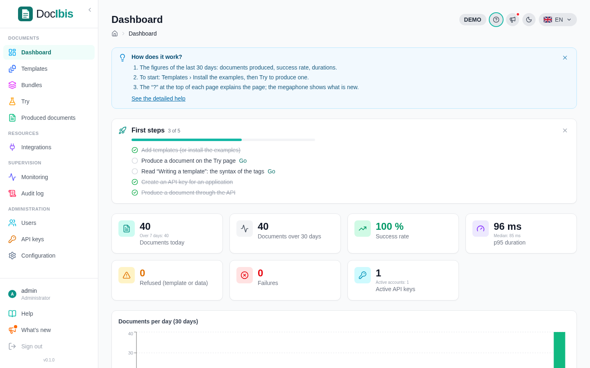
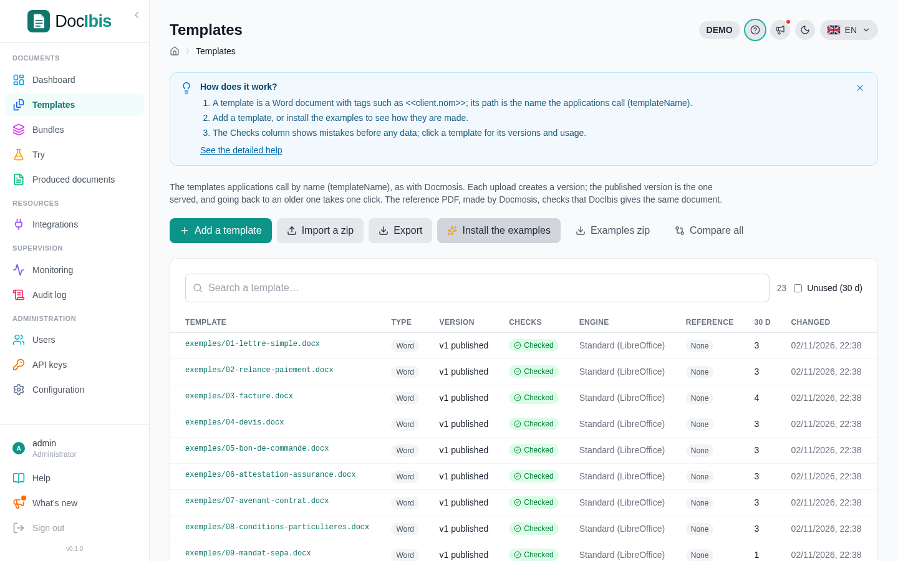
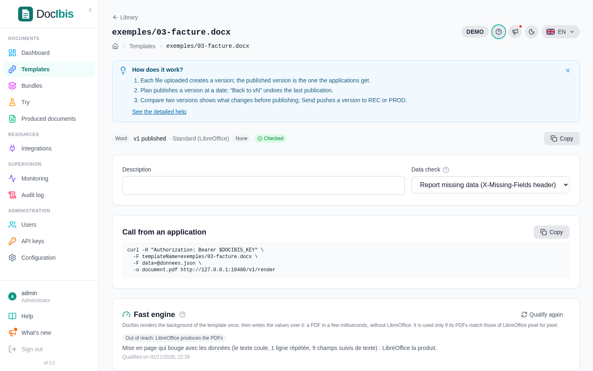

Five steps take you from an empty DocIbis to a document produced by your own application. The dashboard follows them in its **First steps** card.



## 1. Install the examples

Open **Templates** and click **Install the examples**. DocIbis adds 23 sample templates, with their data, in the `exemples/` folder: a letter, an invoice, a quote, an order form, a certificate, a shipping label…



## 2. Try a template

Open **Try**, pick a template and click **Use the example**: the form shows its data. Change a value, click **Produce the PDF** and the document appears next to the form, ready to download.

## 3. Read “Writing a template”

**Help → Writing a template** explains the tags in a few minutes. The short version is in [Write a template](/docibis/guides/templates/).

## 4. Create an API key

Open **API keys** and create a key for each application, for example `Billing app`. Copy the secret now: DocIbis only keeps its hash. A key can expire and has a rate limit.

## 5. Produce a document through the API

Each template page shows the call to copy, ready for your application:



```bash
curl -H "Authorization: Bearer $DOCIBIS_API_KEY" \
  -F templateName=exemples/03-facture.docx \
  -F data=@invoice.json \
  -o invoice.pdf https://docs.example.com/v1/render
```

The answer is the PDF. Every call then appears in **Produced documents** and on the dashboard.

Next: [write your own template](/docibis/guides/templates/).
