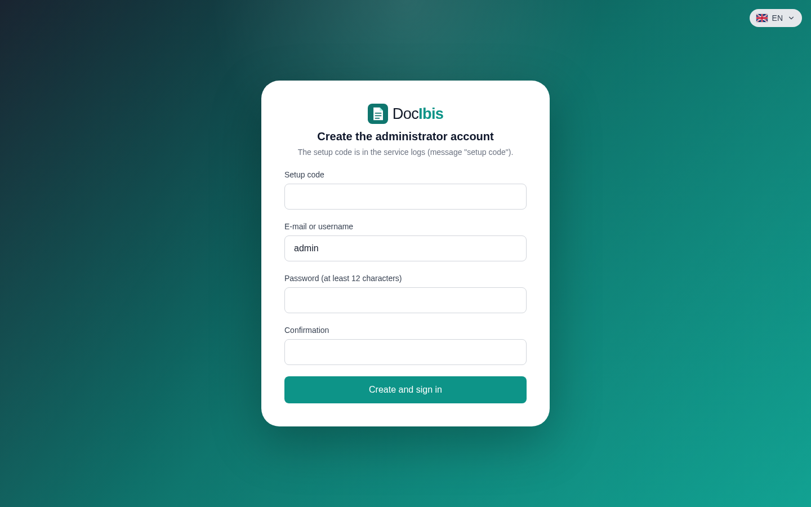

DocIbis runs with Docker on one Linux server. One command installs everything: Docker if needed, the DocIbis containers and their configuration.

## What you need

- A Linux server or virtual machine, `amd64` (x86-64), with `curl`.
- `root` access, or a user with `sudo`.
- At least 2 GB of memory and 4 GB of free disk.
- TCP port `8080` open, or `80` and `443` if you give a domain name for HTTPS.

## Run the installer

```bash
curl -fsSL https://raw.githubusercontent.com/drslid/docibis/v0.1.0/install.sh | sudo env DOCIBIS_REF=v0.1.0 bash
```

The installer asks two questions:

1. **The database.** Press Enter to keep SQLite: nothing else to install. Choose PostgreSQL 18 in Docker, or give the address of an existing PostgreSQL (15 or later), if you plan several servers. See [Configuration](/docibis/operations/configuration/).
2. **The domain name** (optional). With a domain name that points to the server, DocIbis gets and renews an HTTPS certificate on its own. Without one, it answers in plain HTTP on port `8080`.

It then installs Docker if needed, writes `/opt/docibis/.env` with generated secrets, pulls the images and starts DocIbis. At the end, it prints the address and a one-time setup code:

```text
==> DocIbis is running: http://203.0.113.10:8080
    Setup code: K7QM-2XV9
    Open the address, enter this code and create the first administrator.
```

Open the address and enter the code: you create the first administrator account, then its second factor with an authenticator app.



:::tip
Keep a copy of `/opt/docibis/.env` elsewhere. Its `APP_SECRET_KEY` encrypts the backups and protects the second-factor secrets of the accounts: without it, no backup can be read.
:::

## Install without questions

Give the answers as variables, for example PostgreSQL in Docker and HTTPS:

```bash
curl -fsSL https://raw.githubusercontent.com/drslid/docibis/v0.1.0/install.sh \
  | sudo env DOCIBIS_REF=v0.1.0 DOCIBIS_YES=1 DOCIBIS_DB=postgres DOCIBIS_DOMAIN=docs.example.com bash
```

| Variable               | Values                                        | Default        |
| ---------------------- | --------------------------------------------- | -------------- |
| `DOCIBIS_REF`          | release tag, or `main` for the latest build   | `main`         |
| `DOCIBIS_DIR`          | installation folder                           | `/opt/docibis` |
| `DOCIBIS_DB`           | `sqlite`, `postgres` or `external`            | `sqlite`       |
| `DOCIBIS_DATABASE_URL` | `postgres://…` address, with `external`       |                |
| `DOCIBIS_DOMAIN`       | domain name pointing to the server, for HTTPS | plain HTTP     |
| `DOCIBIS_PORT`         | HTTP port, without a domain                   | `8080`         |
| `DOCIBIS_YES`          | `1`: use the variables, ask nothing           |                |

Next: [first steps](/docibis/getting-started/first-steps/).
