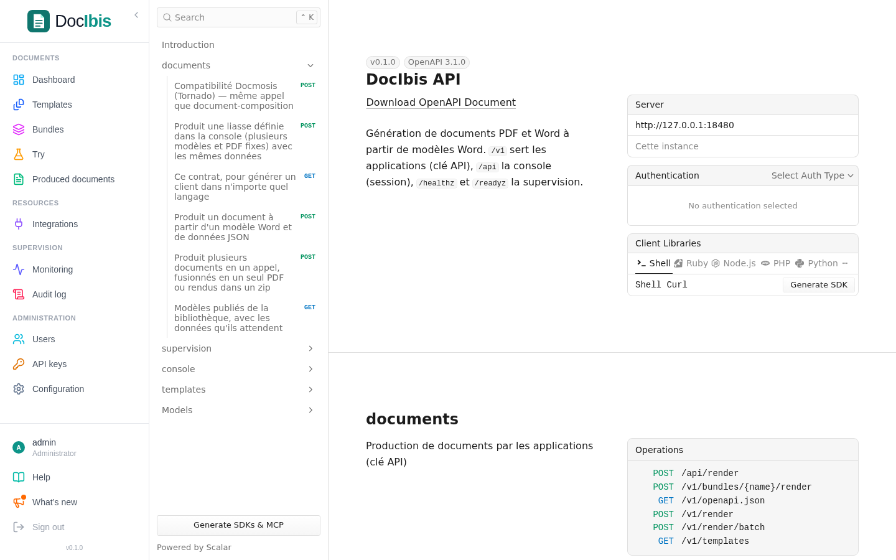
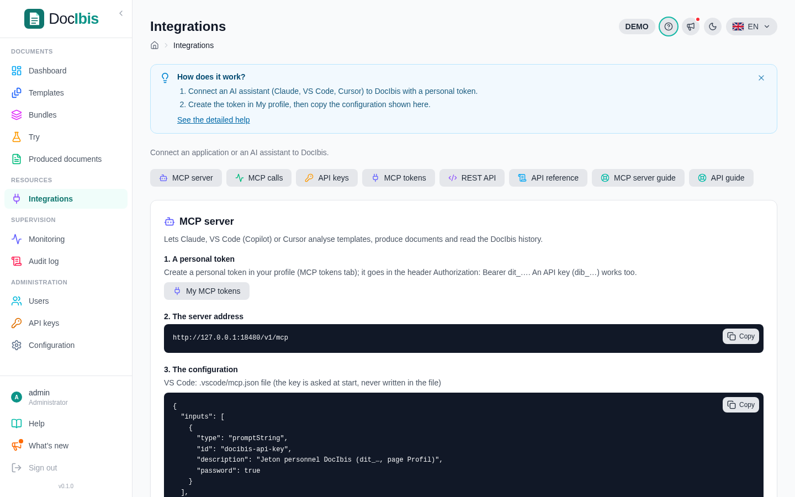

Applications call DocIbis over HTTPS with an API key. The interactive reference of every call is in the console, at `/docs`.



## Produce one document

`POST /v1/render` takes a form (`multipart/form-data`): the template, by its name in the library (`templateName`) or as a file (`template`), and the JSON data (`data`). The answer is the document.

```bash
curl -H "Authorization: Bearer $DOCIBIS_API_KEY" \
  -F templateName=exemples/03-facture.docx \
  -F data=@invoice.json \
  -o invoice.pdf https://docs.example.com/v1/render
```

Useful options, as form fields:

| Field                                  | Effect                                           |
| -------------------------------------- | ------------------------------------------------ |
| `format=docx`                          | a Word document instead of a PDF                 |
| `outputName=invoice-0512.pdf`          | the file name given to the document              |
| `pdfa=PDF/A-2b`                        | an archival PDF (`PDF/A-1b`, `2b` or `3b`)       |
| `accessible=true`                      | a tagged PDF, for screen readers                 |
| `watermark=COPY`                       | a watermark on every page                        |
| `passwordProtect=…`                    | a password to open the PDF                       |

The `X-Render-Ms` header gives the time taken. Errors come back as JSON (`application/problem+json`) with a readable `detail`.

## Several documents at once

- **Batch:** `POST /v1/render/batch` produces many documents in one call and returns a ZIP file.
- **Bundles:** a bundle groups several templates and fixed PDF files (terms and conditions, for example) into one PDF; `POST /v1/bundles/{name}/render`.

## Coming from Docmosis

DocIbis answers the Docmosis call `POST /api/render` with the same fields (`accessKey`, `templateName`, `outputName`, `data` and the PDF options). Point the client to DocIbis, give it a DocIbis API key as `accessKey`, and import its templates in the library. Compare a few documents before switching: the **reference documents** of each template do it page by page.

## Integrations

The **Integrations** page gathers what an application or an AI assistant needs: the address of the MCP server, its configuration for Claude, VS Code or Cursor, the keys and the guides.



- **AI assistants:** the MCP server at `/v1/mcp` lets an assistant list templates and produce documents with the rights of its API key.
- **Monitoring tools:** Prometheus metrics at `/metrics`, protected by `METRICS_TOKEN`.
