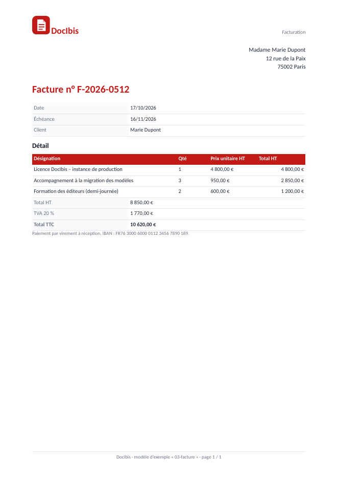

A template is an ordinary Word document (`.docx`), or an Excel workbook or PowerPoint presentation (see below). Where the data goes, you type a tag between `<<` and `>>`. DocIbis reads the same tags as Docmosis, so existing Docmosis templates work as they are.

## The data

Your application sends JSON, for example:

```json
{
  "client": { "name": "Marie Dupont", "vip": true },
  "date": "2026-10-17",
  "lines": [
    { "label": "Licence", "quantity": 1, "price": 4800 },
    { "label": "Training", "quantity": 2, "price": 600 }
  ]
}
```

## The tags

| In the Word template                                   | Produces                                     |
| ------------------------------------------------------ | -------------------------------------------- |
| `<<client.name>>`                                      | a value of the data                          |
| `<<price{numFormat='#,##0.00'}>>`                      | a formatted number                           |
| `<<date{dateFormat='dd/MM/yyyy'}>>`                    | a formatted date                             |
| `<<cs_{client.vip = true}>>` … `<<else>>` … `<<es_>>`  | a section shown only when the test is true   |
| `<<rr_lines>>` … `<<er_lines>>`                        | one table row per item of `lines`            |
| `<<rs_lines>>` … `<<es_lines>>`                        | one section per item                         |
| `<<$itemNum>>`                                         | the number of the item in a repeat           |
| `<<{toUpper(client.name)}>>`                           | an expression with functions                 |
| `<<op:client.address2>>`                               | a paragraph removed when the value is empty  |
| `<<link:client.website>>`                              | a hyperlink                                  |
| `<<{qrcode(contract.link)}>>`                          | a QR code; `barcode(…)` for a barcode        |
| an image with the bookmark `imgfit_logo`               | the image of the field `logo`, fitted        |

The console lists every tag in **Help → Writing a template** and in the **Tag cheat sheet** of the Try page.

## Excel and PowerPoint templates

A workbook (`.xlsx`, `.ods`) or a presentation (`.pptx`, `.odp`) takes the same tags, typed in cells, text boxes and slide titles. LibreOffice always produces these documents.

- **Repeated rows**: `<<rr_lines>>` in the first cell of a sheet or table row and `<<er_>>` in the last one repeat the row for each item.
- **Numbers and dates**: a cell holding a single field (`<<price>>`) gets a real number, or a real date for a value like `2026-11-06`, so formulas can compute with it.
- **Formulas and charts** of a workbook: a formula of the repeated row (`=B5*C5`) is copied to each row; a sum or a chart that covers the row covers all the rows produced. LibreOffice computes everything again before writing the document.
- **Formats**: a workbook gives PDF, `xlsx` or `ods`; a presentation PDF, `pptx` or `odp`.
- **Refused**: macros, links to other files, data connections, OLE objects and formulas that call an address (`WEBSERVICE`, `DDE`), embedded objects included.

## What you get

The example invoice and its data give this PDF, with the rows repeated and the totals formatted:



## Before publishing

- **Checks at import.** DocIbis reads the template when you add it and reports what would fail, such as a section that is never closed.
- **The data it expects.** The console lists the fields the template uses and generates sample JSON.
- **Versions.** Each upload creates a version. Applications always get the published one; you can plan a publication at a date and go back to the previous version.
- **Names.** Rename a template and its old path stays a former name: applications that still call it keep working until an administrator removes it. Merging two templates adds the other's missing versions, in their order, and keeps its names.
- **Reference documents.** Attach the PDFs a template must reproduce (for example the ones Docmosis made): DocIbis compares each new version with them, page by page.
- **Data check.** Per template, choose what happens when the data lacks a field: refuse the call (`strict`), report it in the `X-Missing-Fields` header (`warn`), or ignore it (`off`).
