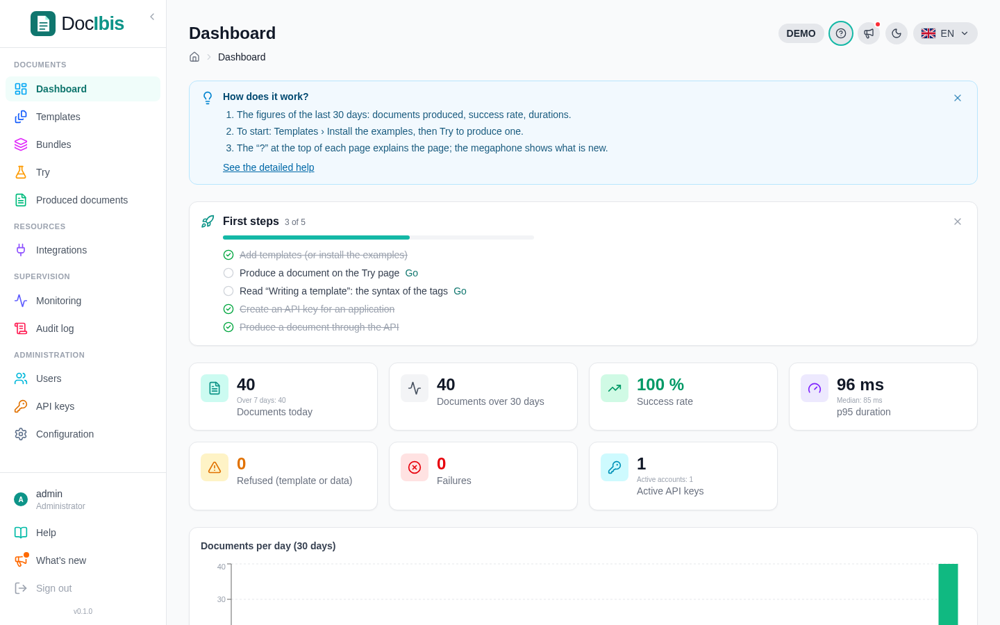

import { Card, CardGrid, Steps } from '@astrojs/starlight/components';

## How it works

<Steps>

1. **Write the document in Word.** Put tags where the data goes: `<<client.name>>`, a table row repeated per line, a section shown only for some customers.

2. **Add it to the DocIbis library.** The console checks the template, keeps its versions and publishes the one your applications use.

3. **Send the data, get the PDF.** Your application sends JSON to DocIbis and receives the finished document, usually in a fraction of a second.

</Steps>

```bash
curl -H "Authorization: Bearer $DOCIBIS_API_KEY" \
  -F templateName=exemples/03-facture.docx \
  -F data=@invoice.json \
  -o invoice.pdf https://docs.example.com/v1/render
```



## Why DocIbis

<CardGrid>
	<Card title="Word stays the editor" icon="document">
		Business teams design documents in Word. Developers only send data.
	</Card>
	<Card title="Docmosis-compatible" icon="random">
		Same tag syntax and a compatible `/api/render` call: existing templates and clients keep working.
	</Card>
	<Card title="Self-hosted" icon="laptop">
		One command installs it with Docker on your server. Documents and data stay with you.
	</Card>
	<Card title="Safe publishing" icon="approve-check">
		Versions, checks at import, comparison with reference PDFs, scheduled publication and rollback.
	</Card>
</CardGrid>

## Where to start

<CardGrid>
	<Card title="Install" icon="rocket">
		[One command](/docibis/getting-started/install/) on a Linux server, then [first steps](/docibis/getting-started/first-steps/).
	</Card>
	<Card title="Write a template" icon="pencil">
		[The tags](/docibis/guides/templates/) for fields, tables, conditions, images and QR codes.
	</Card>
	<Card title="Call the API" icon="puzzle">
		[Produce documents](/docibis/guides/api/) from any language, or move a Docmosis client.
	</Card>
	<Card title="Run it" icon="setting">
		[Database, HTTPS, fonts](/docibis/operations/configuration/) and [updates and backups](/docibis/operations/maintenance/).
	</Card>
</CardGrid>
