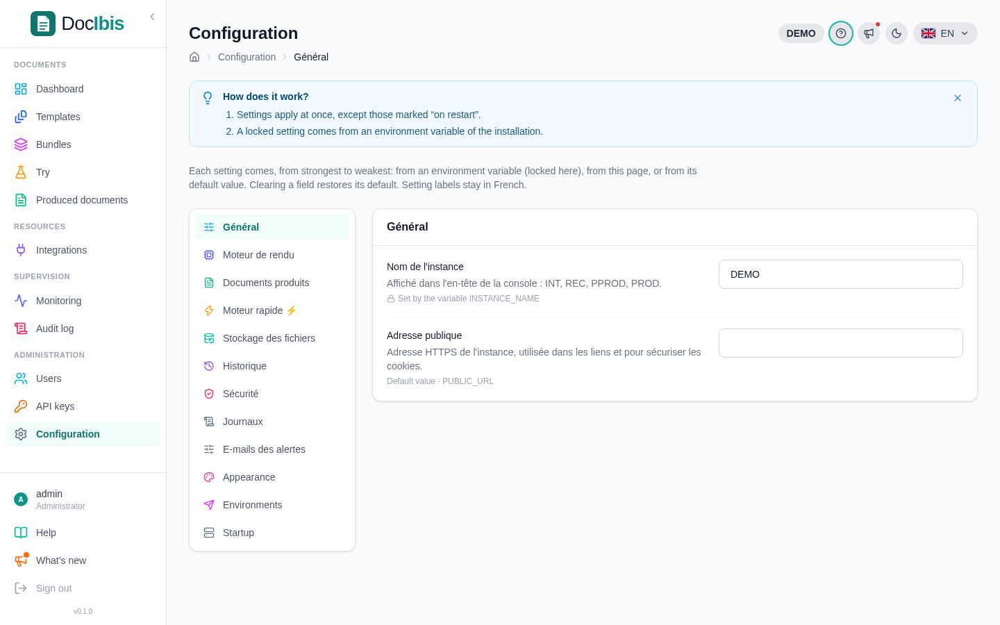

The installer writes the configuration in `/opt/docibis/.env`. After a change, apply it with:

```bash
cd /opt/docibis && docker compose up -d
```

## Database

| Choice                  | In `.env`                                      | For                                    |
| ----------------------- | ---------------------------------------------- | -------------------------------------- |
| SQLite (default)        | `DATABASE_URL=''`                              | one server; data in the `data` volume  |
| PostgreSQL 18 in Docker | `COMPOSE_PROFILES=postgres` and `DATABASE_URL` | one server, ready to grow              |
| Existing PostgreSQL 15+ | `DATABASE_URL='postgres://…'`                  | managed databases, several instances   |

With SQLite, DocIbis keeps a continuous copy of the database in its volume. To send this copy to S3, Cloudflare R2 or MinIO, and restore it automatically on a new server, add:

```bash
STATE_URL=s3://bucket/docibis?region=eu-west-3
AWS_ACCESS_KEY_ID=...
AWS_SECRET_ACCESS_KEY=...
# R2 or MinIO: STATE_URL=s3://bucket/docibis?endpoint=https://storage.example.com&region=auto
```

## HTTPS

Give a domain name to the installer, or set it in `.env`:

```bash
DOCIBIS_DOMAIN=docs.example.com
COMPOSE_FILE=compose.yaml:apps/web/https.compose.yaml
```

Ports `80` and `443` must reach the server. The certificate is obtained and renewed automatically. Behind your own reverse proxy, keep plain HTTP and forward to port `8080`.

## Fonts

The image includes free fonts with the same metrics as Arial, Times New Roman, Courier New, Calibri and Cambria (Liberation, Carlito, Caladea), plus DejaVu and Noto. Licensed fonts, such as Microsoft or corporate fonts, are not distributed: copy their `.ttf` or `.otf` files to `/opt/docibis/fonts`, then:

```bash
cd /opt/docibis && docker compose restart api
```

## Settings in the console

Everything else is set in the console, under **Configuration**: limits, retention of the history, e-mail, security (second factor, sessions), allowed image addresses and the branding of the console.



## `.env` reference

| Variable                | Role                                                                 |
| ----------------------- | -------------------------------------------------------------------- |
| `APP_SECRET_KEY`        | encrypts the backups and seals the second-factor secrets; generated, keep a copy elsewhere |
| `INSTANCE_NAME`         | name shown in the console, for example `PROD` or `TEST`              |
| `DOCIBIS_VERSION`       | image tag: a release such as `v0.2.1`, or `edge`                      |
| `DOCIBIS_PORT`          | HTTP port, `8080` by default                                         |
| `DOCIBIS_DOMAIN`        | domain name for HTTPS                                                |
| `DATABASE_URL`          | empty for SQLite, or a `postgres://` address                         |
| `STATE_URL`             | optional copy of the SQLite database, and the backups, in S3, R2 or MinIO |
| `SMTP_PASSWORD`         | password of the mail server set in the console                       |
| `METRICS_TOKEN`         | token required to read `/metrics`                                    |
